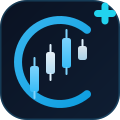
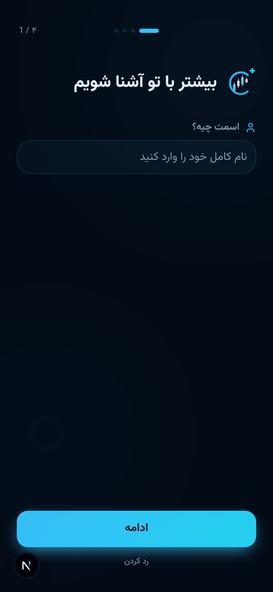
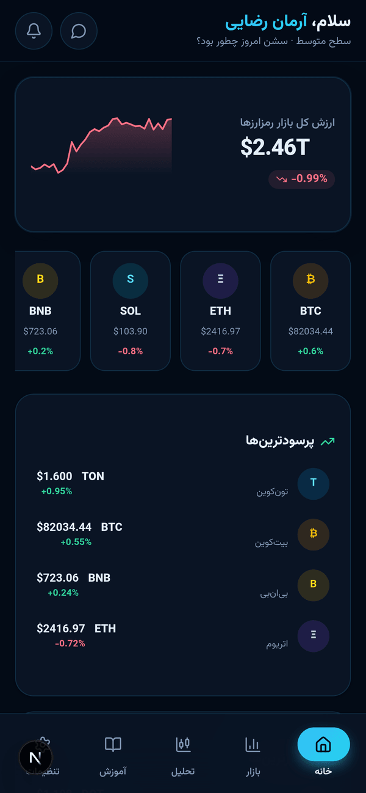
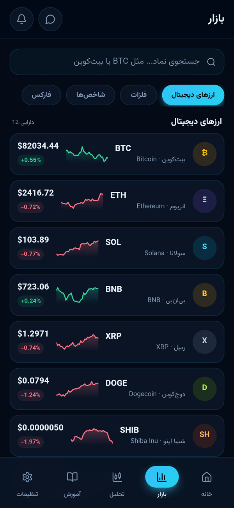
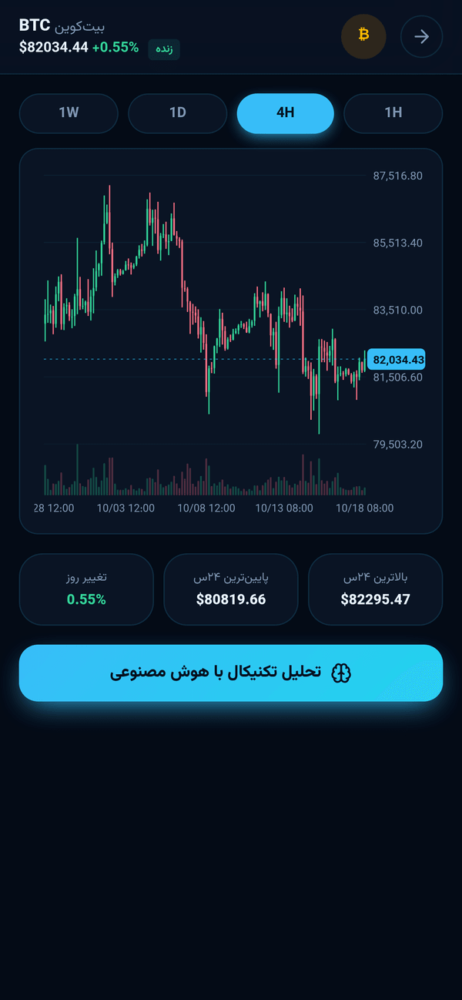
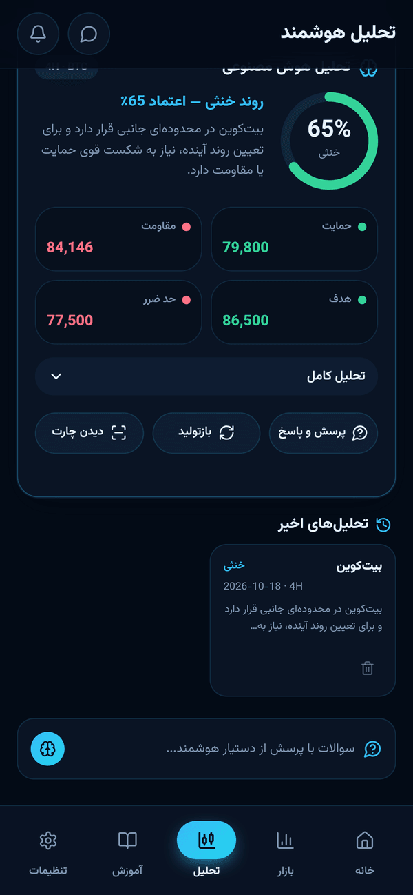
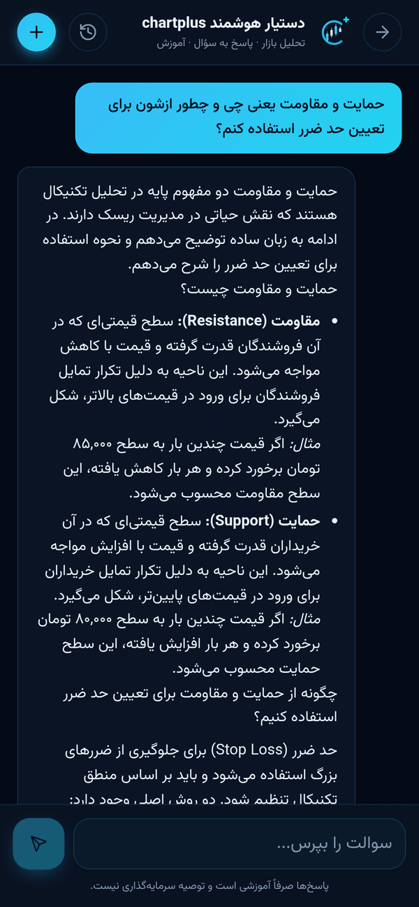
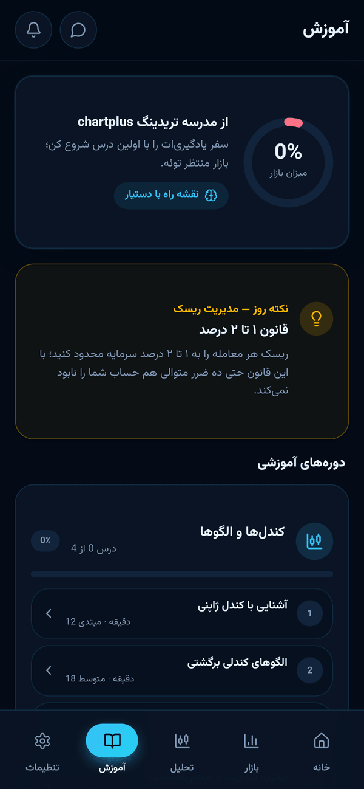
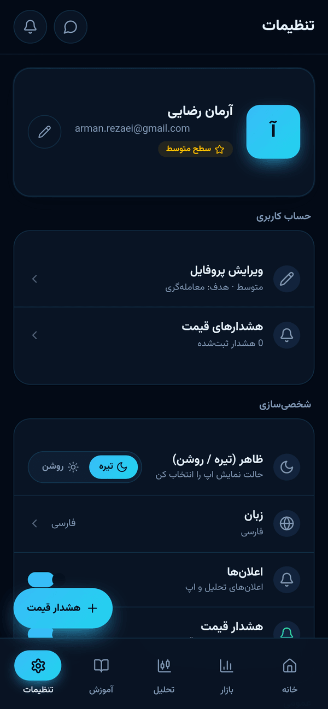
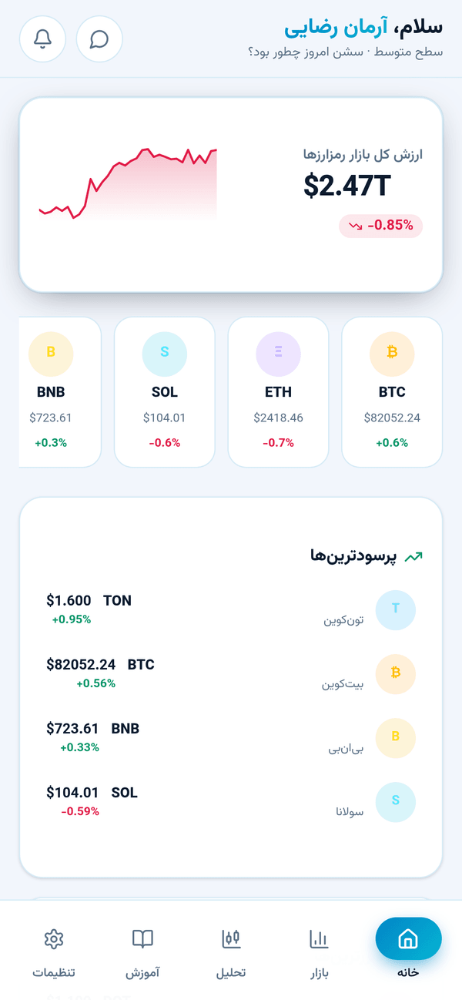

<div align="center">



# chartplus

**اپلیکیشن فارسی ترید و تحلیل بازارهای جهانی با دستیار هوش مصنوعی**

A Persian (Farsi) mobile-first trading & market analysis app with an AI assistant — built with Next.js 16, TypeScript and PWA.


[ویژگی‌ها](#ویژگیها) · [نمایی از اپ](#نمایی-از-اپلیکیشن) · [راه‌اندازی](#راهاندازی-getting-started) · [خروجی APK](#خروجی-apk-اندروید) · [API ها](#ساختار-api-ها)

</div>

---

## نمایی از اپلیکیشن

| | | |
|---|---|---|
|  |  |  |
| **آنبوردینگ ۴ مرحله‌ای** | **خانه — دوربین بازار** | **بازار — قیمت زنده** |
|  |  |  |
| **چارت کندل‌استیک** | **تحلیل تکنیکال با AI** | **چت با دستیار و تاریخچه** |
|  |  |  |
| **آموزش و نکته روز** | **تنظیمات و هشدار قیمت** | **تم روشن** |

## معرفی

chartplus یک اپلیکیشن فارسی و موبایل‌محور برای **ترید و تحلیل بازارهای جهانی** است که با **Next.js 16** ساخته شده است. قیمت لحظه‌ای رمزارزها، چارت کندل‌استیک، تحلیل تکنیکال با هوش مصنوعی (تحلیل تصویر چارت و چت با دستیار)، دوره آموزشی کامل و مدیریت هشدار قیمت — همه در یک اپ با رابط کاربری کاملاً راست‌به‌چپ، فونت وزیرمتن و تم سرمه‌ای/فیروزه‌ای.

## ویژگی‌ها

- **اسپلش با لوگو** در هر اجرای برنامه
- **آنبوردینگ ۴ مرحله‌ای** — نام، جیمیل، سطح تجربه و هدف معاملاتی
- **خانه** — وضعیت کلی بازار، برترین‌های پرسود و پرضرر و تحلیل روزانه هوش مصنوعی
- **بازار** — قیمت زنده، جستجوی دارایی، چارت کندل‌استیک و انتخاب تایم‌فریم (۱ ساعت تا ۱ هفته)
- **تحلیل هوشمند** — آپلود تصویر چارت یا انتخاب ارز؛ خروجی روند، حمایت، مقاومت، هدف قیمتی و حد ضرر به‌همراه چت با دستیار
- **چت با هوش مصنوعی** — گفتگوی فارسی با زمینه زنده بازار و تاریخچه جلسات قابل مدیریت (رندر مارک‌داون)
- **آموزش** — ۱۵ درس در ۴ دسته (کندل‌شناسی، اندیکاتورها، مدیریت سرمایه، روانشناسی) با نکته روز و رهگیری پیشرفت
- **تنظیمات کامل** — پروفایل، تم تیره/روشن، اعلان‌ها، هشدار قیمت و بخش امنیت
- **PWA و RTL کامل** — نصب‌شدنی روی موبایل و دسکتاپ، آماده تبدیل به APK اندروید

## تکنولوژی‌ها

Next.js 16 (App Router) · TypeScript · Tailwind CSS 4 · shadcn/ui · Prisma (SQLite) · TanStack Query · Zustand · z-ai-web-dev-sdk (LLM + Vision) · Framer Motion · Vazirmatn

## معماری پروژه

ساختار پوشه‌ها به‌صورت خلاصه:

```
src/
├── app/
│   ├── api/                # بک‌اند (Route Handlers)
│   │   ├── market/         #   قیمت زنده و کندل‌ها
│   │   ├── analysis/       #   تحلیل هوشمند (تصویر/نماد)
│   │   ├── chat/           #   چت با دستیار و جلسات
│   │   ├── lessons/        #   درس‌ها و پیشرفت آموزش
│   │   ├── alerts/         #   هشدارهای قیمت
│   │   ├── profile/        #   پروفایل و تنظیمات
│   │   └── ai/daily/       #   نکته و تحلیل روزانه
│   ├── layout.tsx
│   └── page.tsx            # اپ تک‌صفحه‌ای (App Shell با تب‌ها)
├── components/             # کامپوننت‌های UI (تب‌ها، چارت‌ها، آنبوردینگ و…)
├── hooks/                  # هوک‌های TanStack Query و…
└── lib/
    ├── market.ts           # موتور بازار (بایننس + شبیه‌سازی داخلی)
    ├── ai.ts               # لایه هوش مصنوعی (z-ai-web-dev-sdk)
    ├── lessons.ts          # محتوای ۱۵ درس آموزشی
    ├── tips.ts             # نکته‌های روزانه
    ├── store.ts            # مدیریت state با Zustand
    └── db.ts               # کلاینت Prisma
prisma/schema.prisma        # مدل‌های دیتابیس
public/                     # manifest، سرویس‌ورکر، فونت وزیرمتن و آیکون‌ها
screenshots/                # تصاویر معرفی پروژه
db/custom.db                # دیتابیس SQLite (ساخته‌شدنی با db:push)
```

## منبع داده (نکته مهم)

قیمت‌های **رمزارز** از API عمومی **Binance** دریافت می‌شود و در صورت عدم دسترسی (مثلاً تحریم شبکه یا قطعی)، **موتور شبیه‌سازی داخلی** به‌صورت خودکار و بدون خطا جایگزین می‌شود؛ بنابراین اپ همیشه کار می‌کند. داده‌های **فلزات، شاخص‌ها و فارکس** به‌صورت شبیه‌سازی‌شده و صرفاً برای نمایش ارائه می‌شوند.

## هوش مصنوعی (نکته)

قابلیت‌های هوش مصنوعی (تحلیل چارت، چت دستیار و تحلیل روزانه) با **z-ai-web-dev-sdk** پیاده‌سازی شده‌اند. برای اجرای خارج از محیط سندباکس، طبق مستندات همان SDK به آن دسترسی بدهید یا لایه `src/lib/ai.ts` را به سرویس سازگار دیگری متصل کنید. در نبودِ دسترسی به AI، اپ به‌صورت **گرِیس‌فول** خطای دوستانه نمایش می‌دهد و بقیه بخش‌ها سالم باقی می‌مانند.

## راه‌اندازی (Getting Started)

### پیش‌نیازها

- **Node.js 20+** یا **Bun 1.1+**
- (اختیاری برای دیتابیس) هیچ سرویس خارجی لازم نیست؛ SQLite فایلی است.

### مراحل نصب و اجرا

```bash
# ۱) کلون پروژه
git clone https://github.com/asghari-it/chartplus.git
cd chartplus

# ۲) نصب وابستگی‌ها
bun install        # یا: npm install

# ۳) متغیرهای محیطی
cp .env.example .env

# ۴) ساخت و همگام‌سازی دیتابیس
bun run db:push    # یا: npm run db:push

# ۵) اجرا در حالت توسعه
bun run dev        # یا: npm run dev
```

سپس `http://localhost:3000` را باز کنید.

### نسخه پروداکشن

```bash
bun run build      # ساخت خروجی standalone
bun run start      # اجرای سرور پروداکشن
```

> اگر Bun ندارید، پس از build می‌توانید خروجی را با `node .next/standalone/server.js` اجرا کنید.

## خروجی APK (اندروید)

چون اپ یک **PWA کامل** است (شامل `manifest.json` و سرویس‌ورکر)، دو مسیر برای گرفتن بسته اندروید دارید:

### روش ۱ — PWA + PWABuilder (ساده‌ترین، پیشنهادی)

1. اپ را روی یک هاست با HTTPS مستقر کنید؛ مثلاً روی Vercel:
   ```bash
   npm i -g vercel
   vercel --prod
   ```
2. به [pwabuilder.com](https://www.pwabuilder.com) بروید و آدرس سایت را وارد کنید و دکمه **Start** را بزنید.
3. پس از آنالیز، مطمئن شوید امتیاز **Manifest** و **Service Worker** سبز است (این اپ هر دو را دارد).
4. روی **Package for stores** و سپس **Android** کلیک کنید.
5. در تنظیمات بسته، **Package ID** را `app.chartplus.app` بگذارید، نام و آیکون اپ را تأیید کنید و فرمت خروجی (APK برای تست، AAB برای پلی‌استور) را انتخاب کنید.
6. روی **Download** بزنید؛ یک فایل zip شامل بسته‌های امضاشده و راهنمای تست دریافت می‌کنید.
7. فایل `app-release-signed.apk` را به گوشی منتقل و نصب کنید (فعال‌کردن «نصب از منابع ناشناس») یا فایل `.aab` را در **Google Play Console** آپلود کنید.

### روش ۲ — Capacitor (کنترل کامل نیتیو)

```bash
# نصب پکیج‌ها
npm i @capacitor/core @capacitor/cli @capacitor/android

# مقداردهی اولیه
npx cap init chartplus app.chartplus.app --web-dir=public

# افزودن پلتفرم اندروید و باز کردن پروژه در Android Studio
npx cap add android
npx cap open android
```

> **توضیح مهم:** چون این پروژه Next.js با SSR و API Route است، WebView نمی‌تواند فقط از فایل‌های استاتیک کار کند. دو راه دارید:
> ۱. آدرس سرور مستقر خود را در `capacitor.config.ts` با `server.url` ست کنید (ساده‌ترین راه — نمونه زیر)؛
> ۲. یا نسخه استاتیک بسازید که در این پروژه به‌دلیل API Route ها بدون تغییر ساختار توصیه نمی‌شود.

نمونه فایل `capacitor.config.ts` (این فایل را در پروژه نسازید؛ فقط در صورت استفاده از Capacitor بسازید):

```ts
import type { CapacitorConfig } from "@capacitor/cli";

const config: CapacitorConfig = {
  appId: "app.chartplus.app",
  appName: "chartplus",
  webDir: "public",
  // چون Next.js سمت سرور رندر می‌کند، WebView به سرور مستقر شما وصل می‌شود:
  server: {
    url: "https://your-domain.example.com",
    cleartext: false,
  },
};

export default config;
```

ساخت APK در Android Studio: از منوی **Build > Build App Bundle(s) / APK(s) > Build APK(s)** استفاده کنید. خروجی در مسیر `android/app/build/outputs/apk/debug/` ذخیره می‌شود. برای انتشار در پلی‌استور از **Build > Generate Signed Bundle / APK** با کلید امضای خودتان استفاده کنید.

### مقایسه دو روش

| | روش ۱: PWABuilder | روش ۲: Capacitor |
|---|---|---|
| سطح سختی | خیلی ساده | متوسط |
| پیش‌نیاز | فقط آدرس سایت deploy‌شده | Android Studio + JDK |
| زمان تقریبی | حدود ۱۰ دقیقه | بیشتر (راه‌اندازی SDK اندروید) |
| خروجی | APK / AAB امضاشده | APK / AAB از Android Studio |
| دسترسی نیتیو | محدود | کامل (پلاگین‌های Capacitor) |
| مناسب برای | انتشار سریع در پلی‌استور | کنترل کامل و توسعه نیتیو |

## ساختار API ها

| Endpoint | متدها | توضیح |
|---|---|---|
| `/api/market` | GET | قیمت لحظه‌ای همه دارایی‌ها (زنده یا شبیه‌سازی) |
| `/api/market/candles` | GET | کندل‌ها با پارامترهای `symbol`، `tf` و `limit` |
| `/api/analysis` | GET, POST | تاریخچه تحلیل‌ها / تحلیل جدید (تصویر چارت یا نماد) |
| `/api/analysis/[id]` | DELETE | حذف یک تحلیل |
| `/api/chat` | POST | گفتگو با دستیار (با زمینه زنده بازار) |
| `/api/chat/sessions` | GET, POST | فهرست جلسات / ساخت جلسه جدید |
| `/api/chat/sessions/[id]` | GET, DELETE | پیام‌های جلسه / حذف جلسه |
| `/api/profile` | GET, POST, PATCH, DELETE | مدیریت پروفایل و تنظیمات |
| `/api/lessons` | GET, POST | درس‌های آموزشی / ثبت پیشرفت |
| `/api/ai/daily` | GET | نکته روز و تحلیل روزانه بازار |
| `/api/alerts` | GET, POST, PATCH, DELETE | مدیریت هشدارهای قیمت |

## مجوز

این پروژه تحت مجوز **MIT** منتشر می‌شود — جزئیات در فایل `LICENSE`.

> این پروژه به‌عنوان **نمونه‌کار (Portfolio)** طراحی شده است و توصیه سرمایه‌گذاری نیست؛ برای تصمیم‌های مالی واقعی به آن اتکا نکنید.
